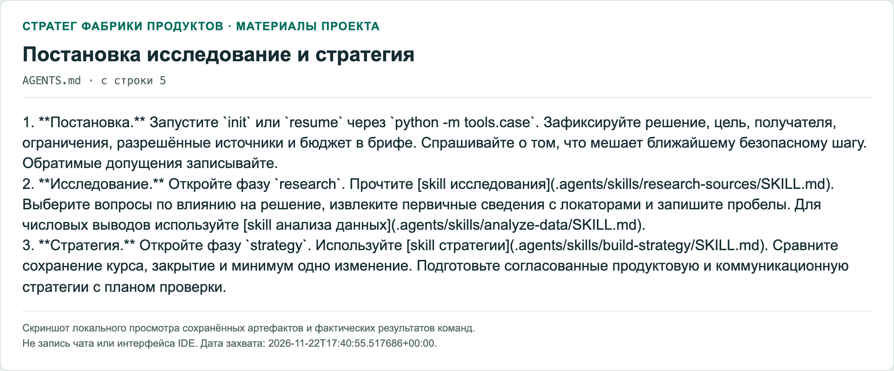
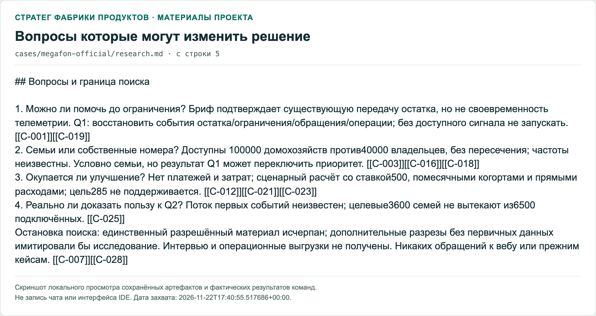
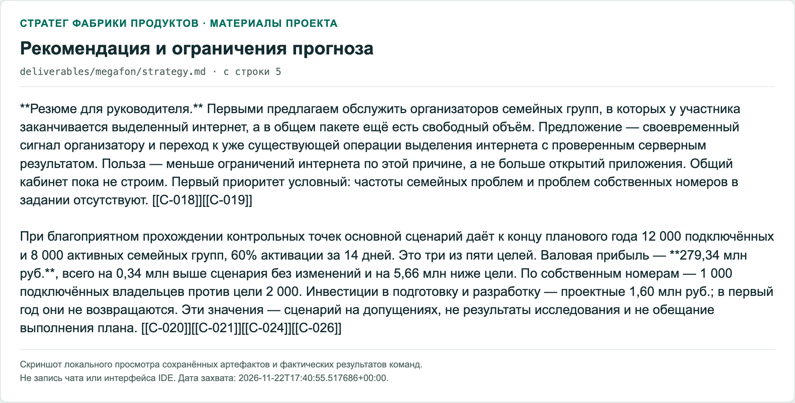
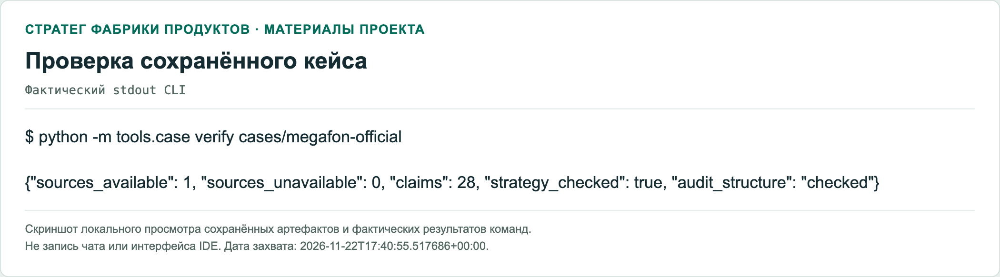
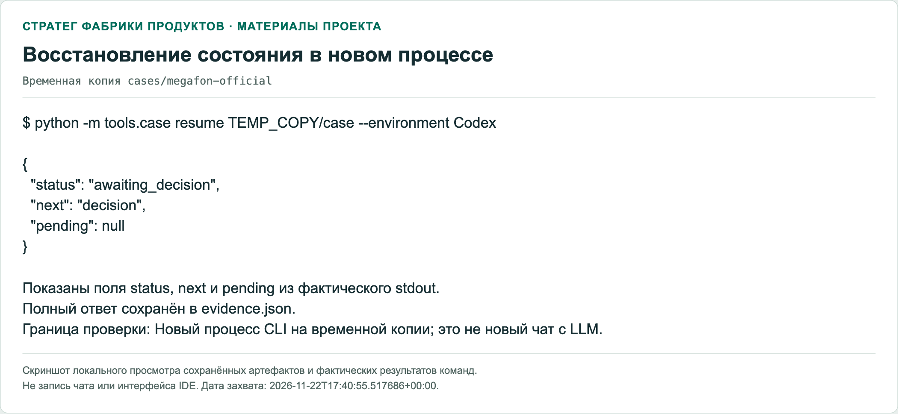

# Описание ИИ агента Стратег Фабрики продуктов

Версия для конкурсной сдачи · 22 ноября 2026 года

## Назначение и результат

Агент помогает руководителю цифрового продукта перейти от неоднозначного запроса к проверяемой рекомендации и сохранить основания решения для продолжения работы.

Проект представляет собой папку для работы с LLM в IDE. Инструкции задают ход работы, четыре skills дают методику текущего шага, а небольшой Python CLI извлекает материалы, ведёт журнал и проверяет контрольные точки. Агент выбирает следующий вопрос и инструмент; существенный выбор направления остаётся за человеком.

Жюри получает исходные материалы, исследование с локаторами, реестр утверждений, пять альтернатив, согласованные продуктовую и коммуникационную стратегии, план проверки и воспроизводимые расчёты. Полная стратегия учебного кейса оформлена отдельно в strategy.pdf на 20 страницах.

Демонстрационный кейс опирается только на предоставленный 11-страничный учебный бриф. Его числа не описывают фактический бизнес МегаФона. Результат — условная стратегия проверки; спрос, причинный эффект и окупаемость не установлены. Решение руководителя по запуску не получено.

| Материал | Где находится в репозитории |
| --- | --- |
| Первый запуск | README.md |
| Описание системы | deliverables/megafon/agent-description.pdf |
| Полная стратегия | deliverables/megafon/strategy.pdf |
| Исходники и доказательства | cases/megafon-official/ |
| Проверки и ограничения сравнения | tests/acceptance.md; tests/benchmark/comparison-report.md |

Основания: README.md; AGENTS.md; cases/megafon-official/brief.md; deliverables/megafon/strategy.md.

## Архитектура контекста и ключевые инструкции

Постоянные правила хранятся в AGENTS.md, переходы и команды — в playbooks/workflow.md, методики — в .agents/skills/. Материалы и состояние задачи лежат отдельно в cases/<имя>/. Агент загружает только skill и файлы текущей фазы. Такое разделение уменьшает лишний контекст и сохраняет проект между чатами; измеренной экономии токенов после этой правки нет.

Ключевая инструкция постановки: «Зафиксируйте решение, цель, получателя, ограничения, разрешённые источники и бюджет в брифе». Ключевой принцип исследования: «Запишите в research.md вопросы, у которых ответ способен поменять выбор». Ключевое правило стратегии: сравнить сохранение курса, закрытие и минимум одно изменение.

Перед записью артефактов кейса открывается фаза begin; finish закрепляет хеши завершённых файлов. state.json хранит следующий шаг, run.tsv — попытки и ошибки. Восстановление начинается с resume и сверки журнала. Завершённые основания сохраняются, изменение данных оформляется отдельной ревизией.

Источники считаются данными: найденные внутри команды не меняют инструкции и не исполняются. Манифест inputs.json ограничивает доступные материалы и число веб-запросов. Один кейс ведёт один пишущий сеанс.

Полные инструкции: AGENTS.md; playbooks/workflow.md; .agents/skills/{research-sources,analyze-data,build-strategy,check-evidence}/SKILL.md.

## Исследование и доказательства

Постановка конкурсного кейса: подготовить стратегию по локальному брифу, не использовать прежние кейсы, не делать веб-запросов, сравнить семьи и собственные номера, сохранить неизвестные частоты и затраты. Этот запрос зафиксирован в cases/megafon-official/brief.md. Бюджет источников — один PDF и ноль прямых веб-запросов.

Агент выделил четыре вопроса: можно ли помочь до ограничения; какой сегмент проверять первым; окупается ли улучшение; достаточно ли потока для вывода к Q2. По каждому записаны основания, пробел и влияние на выбор. Отсутствие реальных интервью и платежей не заменено синтетическими фактами.

Цепочка проверки: утверждение C → версия источника S → локатор страницы → сохранённый фрагмент → оригинал с SHA-256. Для 28 активных утверждений сохранён содержательный аудит. CLI проверяет происхождение, цитаты, ссылки, структуру стратегии и заполнение аудита. Истинность и достаточность аргумента оценивает автор аудита.

В методике данных отдельно проверяются знаменатели, окна, единицы, наблюдаемость, состав аудитории и чувствительность. Для этого кейса индивидуальных данных нет: дополнительные сравнения и причинные выводы записаны как будущие проверки. Экономическая модель — сценарий на явных допущениях.

Основания: research.md; claims.tsv; sources.tsv; audit.tsv; evidence/S-001@1.jsonl; analysis/metric-passports.md в cases/megafon-official/.

## Варианты и конкурсная рекомендация

Сравнены пять вариантов: временно сохранить обслуживание; закрыть новое направление; проверить ранний сигнал со штатным выделением интернета; построить общий семейный кабинет; проверить автоматический резерв. Для каждого заданы возражения и условия выбора. У кабинета не доказано преимущество над дешёвым сигналом, а его предварительный объём не помещается в ресурс пилота.

Рекомендация — сначала проверить своевременный сигнал организатору семейной группы на одном совместимом тарифе. Продукт использует существующую операцию выделения свободного объёма с согласиями и финальным серверным статусом. Коммуникация обещает подсказать и дать выполнить доступное действие; постоянная связь и гарантированное восстановление не обещаются.

План проверки: семейная рандомизация, обычное обслуживание в контроле, один заранее выбранный индексный номер, семидневное окно, ITT и отдельные ограничения по безопасности, ошибкам и вреду другим участникам. Проектные 3 600 семей и 83,6% мощности против нуля не доказывают достаточность полного правила успеха. Поток и guardrails нужно откалибровать.

Основной сценарий даёт 1 400 дополнительных оплаченных номеро-месяцев: 1 400 × 500 − 360 000 = 340 000 руб. прироста валовой прибыли. Итог 279,34 млн руб. ниже цели 285 млн. Инвестиции 1,60 млн учитываются отдельно и в первый год не возвращаются. Неблагоприятный сценарий даёт 278,742 млн руб. Все новые параметры условны.

Основания: deliverables/megafon/strategy.md, разделы 2–5; cases/megafon-official/analysis/model.py, inputs.json, independent_check.py; quality.md.

## Модели сервисы и инструменты

Продукт работает с одной LLM через учётную запись IDE. Отдельный API-ключ для локального CLI не нужен. Доступ к модели может быть платным; цена зависит от среды и тарифа. Точный фактически использованный идентификатор модели конкурсного кейса не сохранён. В плане исторического A/B указана gpt-6.1-sol с medium, но фактические параметры обоих прогонов не подтверждены. Другие специализированные модели не заявлены.

| Компонент | Роль и граница использования |
| --- | --- |
| Codex и LLM выбранной IDE | Исследование, выбор следующего действия, стратегии, содержательный аудит. Точная модель и денежный usage кейса неизвестны. |
| Codex CLI 0.166.0-alpha.6 | Историческая проверка двух сеансов на пилоте. Это не измерение конкурсного кейса. |
| Cursor | Целевая среда по README; полноценный сквозной запуск и перенос между IDE не подтверждены. |
| Python 3.10+; проверено 3.13.5 | tools.case: init, begin, ingest, verify, finish, pause, resume, log; локальные расчёты. |
| pypdf 6.10.0 | Извлечение текстового слоя PDF. Без OCR. |
| python-docx 1.2.0 | Чтение DOCX: абзацы и таблицы. |
| openpyxl 3.1.5 | Чтение сохранённых значений XLSX. Без пересчёта формул. |
| Стандартная библиотека Python | CSV, TSV, JSON/JSONL, хеши, журнал, статические веб-материалы и расчёты. Decimal — отдельная сверка экономики. |
| Четыре skills в .agents/skills/ | research-sources, analyze-data, build-strategy, check-evidence — повторяемые процедуры по фазам. |
| ReportLab и Arial | Подготовка стратегии PDF и данного описания. Шрифты встроены; библиотека экспорта отдельно от зависимостей запуска агента. |
| Poppler | Рендеринг PDF в PNG и визуальная проверка оформления. |
| Git и локальный ZIP | Версии исходников и переносимый комплект. Удалённая публикация в этом сеансе не выполнялась. |
| Chrome и Playwright | Только подготовка описания: скриншоты локального просмотра файлов и stdout. Не инструменты продуктового исследования. |
| Средства Codex для локальных файлов и зависимостей | Терминал, патчи, просмотр изображений, load_workspace_dependencies при оформлении пакета. Не продуктовая MCP-интеграция. |

Основания: requirements.txt; README.md; tests/acceptance.md; tests/benchmark/comparison-report.md; analysis/export_pdf.py; tools/submission/. Полные ключевые инструкции поставляются в репозитории.

## Запуск проверка и продолжение

Первый запуск: открыть корень в IDE, создать Python-окружение и установить requirements.txt по README. Агент читает AGENTS.md. Для новой задачи написать: «Начни кейс cases/local/retention. Нужно решить, стоит ли менять первый экран сервиса. Публичные сайты пока не разрешаю. Лимит прямых веб-запросов — 0. Продолжай до проверенной рекомендации».

Для паузы: «Приостанови кейс <путь> и сохрани контрольную точку». В новом чате: «Продолжи кейс <путь> по файлам». Исторический тест описывает два независимых сеанса Codex CLI без передачи истории. При оформлении пакета дополнительно запущен resume в новом процессе на временной копии конкурсного кейса: восстановлены awaiting_decision и следующий шаг decision. Это проверка CLI, не новый чат с LLM.

Свежая локальная проверка: полный verify конкурсного кейса успешен, 28 утверждений, audit_structure=checked. Набор unittest прошёл 45 тестов. Файлы исходного конкурсного кейса совпали по хешам до и после проверки. Команда verify не заменяет смысловую оценку.

Свежие результаты: deliverables/megafon/submission/evidence.json. Историческое продолжение: tests/acceptance.md, раздел «Сквозные прогоны»; tests/codex-cli-run.tsv.

## Дополнительные возможности и их проверка

Принцип сложности: один агент и небольшие локальные процедуры закрывают основной путь. Дополнительные модели и интеграции не добавлялись без подтверждённой пользы. Репозиторий хранит основания для дальнейших испытаний, включая неудобные результаты и неизвестные затраты.

| Возможность | Что подтверждено и чем ограничено |
| --- | --- |
| Анализ данных | Сценарная экономика, отдельный алгоритм Decimal, чувствительность; синтетический retention-кейс с k/n, зрелостью и составом. Это не полевые наблюдения. |
| Сохранение знаний и оснований | Версии источников, точные локаторы, claims/audit и хеши; старый ответ служит указателем, а не первичным фактом. Семантический поиск не реализован. |
| Решения и обязательства | В pilot-v2 сохранено учебное D-001 после выбора владельца. В конкурсном кейсе выбор не получен; decision не открыта. |
| Адресный пересмотр | pilot-v3 ссылается на решение и хеши родителя, разбирает новые синтетические данные; новое решение ждёт подтверждения. Фонового мониторинга нет. |
| Устойчивость к сбоям | Автотесты частичных записей, контрольных сумм, завершения по журналу и блокировки неоднозначного сетевого повтора. Это не гарантия любой аварии. |
| Skills и CLI | Четыре методики, локальные команды и контроль фаз. Субагенты, hooks и отдельная маршрутизация моделей в продукте не заявлены. |
| Документы таблицы и сайты | PDF, DOCX, CSV/TSV, XLSX и разрешённые статические материалы. Успешный прямой HTTP через CLI в исходной среде не подтверждён; использовались разрешённые снимки. |
| Сравнение с обычным чатом | Сохранены A/B на синтетическом «Ритме», расчёты и рубрика. Оба результата корректны по проверенным числам; B сильнее связывает выбор с основаниями в оценке одной LLM. |
| Границы сравнения | Нет подтверждения одинаковой фактической модели/effort, полного trace, затрат и независимой слепой оценки. Превосходство по скорости, цене и универсальному качеству не доказано. |

Основания: cases/pilot-v2/decisions.md; cases/pilot-v3/{research,strategy,quality}.md; tests/acceptance.md; tests/evaluations/t8-report.md; tests/benchmark/comparison-report.md.

## Время расходы ошибки и границы

Журнал конкурсного кейса фиксирует 31,105 секунды постановки, 203,834 секунды исследования и 1 032,193 секунды стратегии. Сумма интервалов фаз — 1 267,132 секунды, или около 21 минуты 7 секунд. Это время между командами начала и завершения фаз, включая ожидание; оно не равно полной работе модели или человека. Поздняя приёмка и оформление этого комплекта в сумму не входят.

Токены, денежная стоимость модели, полное активное время человека и суммарная стоимость разработки неизвестны. В этом кейсе записаны один локальный PDF и ноль веб-запросов. Новые платные сервисы для оформления пакета не подключались; имеющийся доступ к IDE не означает нулевую себестоимость. Бюджеты продуктового пилота 0,23/1,60 млн руб. относятся к предлагаемому бизнес-решению, а не расходам ИИ-агента.

Ошибки конкурсного прогона: недоступна необязательная PDF-библиотека — использованы ReportLab и Poppler; проверка нашла отсутствие маркеров в quality.md — выполнены resume, сверка файлов и исправление до завершения. Предупреждения чтения PDF компенсированы визуальной сверкой 11 страниц. При оформлении описания у Playwright отсутствовал загруженный браузер — использован установленный Chrome без скачивания.

Помощь человека: пользователь предоставил бриф, обозначил ограничения и запросил приёмку и оформление. Полного учёта вмешательств и минут нет. Основной агент выполнил исследование, стратегию, расчёты и проверку; второй алгоритм означает независимую реализацию арифметики, а не второго человека. Реальные интервью и пользовательские эксперименты не проводились.

Ограничения: нет OCR, анализа аудио/видео, пересчёта XLSX, авторизованных сайтов и JavaScript-страниц. Нет фонового сопровождения, продуктовой MCP-интеграции или подтверждённого переноса между Codex и Cursor. Права на данные, API, реальные частоты, поток пилота, затраты и достаточность guardrails требуют проверки перед запуском стратегии.

Для подачи капитану остаётся записать видео до 10 минут, загрузить архив либо опубликовать сдаваемую версию репозитория, проверить доступ жюри и отправить ссылки в блоке «Моя работа». По присланному заданию срок — 22 ноября 2026 года, 23:59 МСК. Видео, публикация и отправка заявки в этом пакете не выполнены.

Основания: cases/megafon-official/run.tsv, brief.md, quality.md; deliverables/megafon/acceptance.md; submission/evidence.json; присланный текст конкурсного задания.
